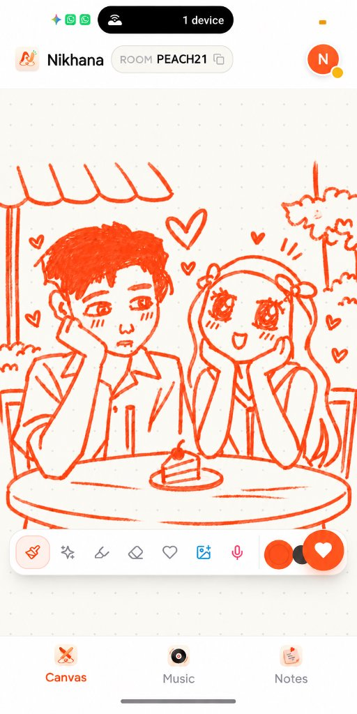
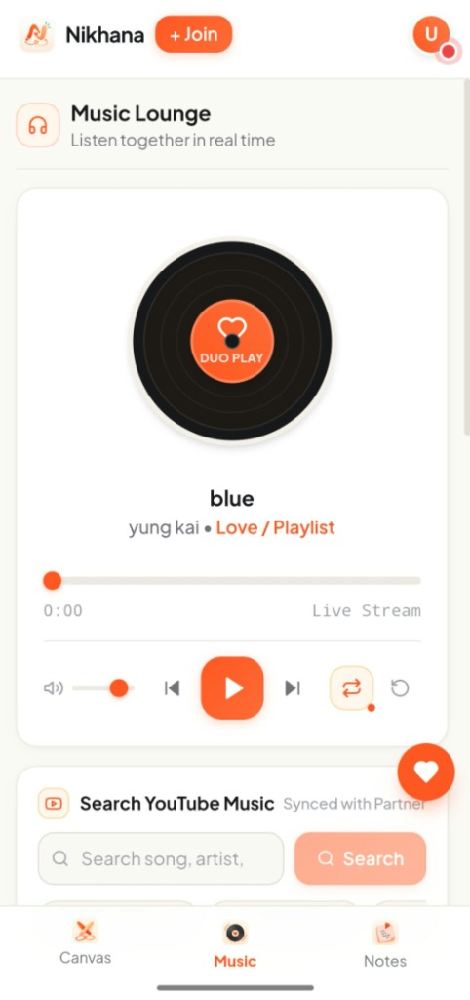
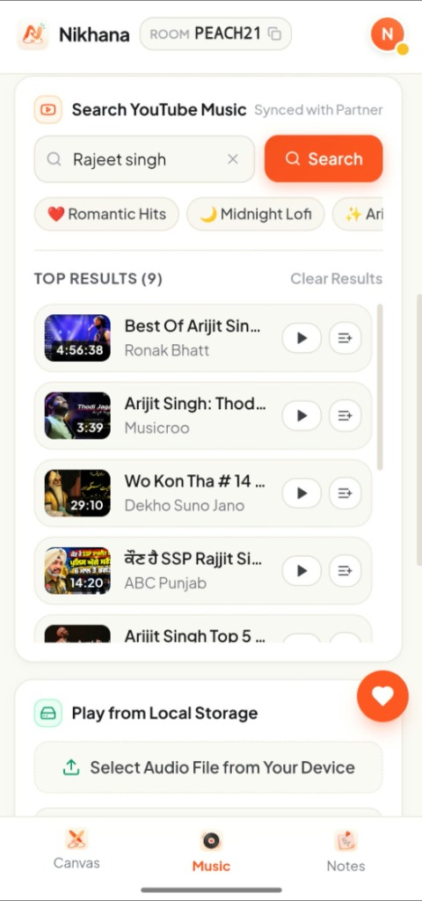
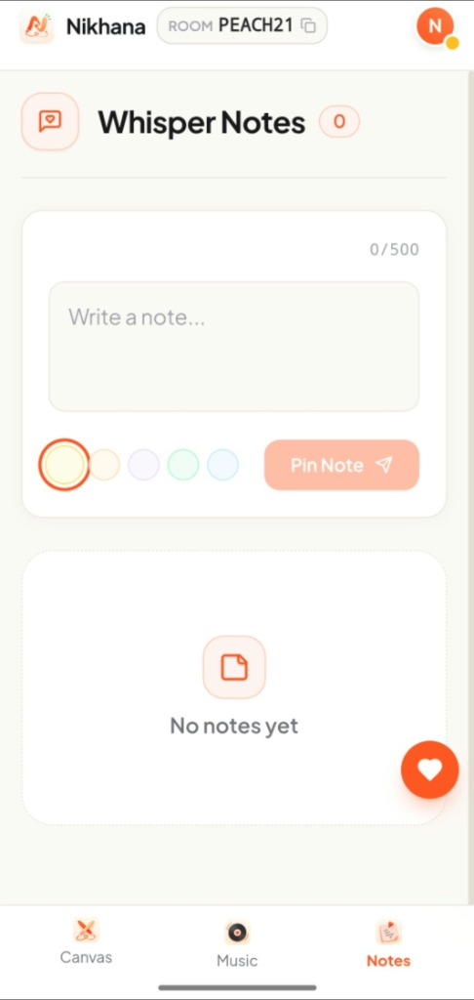

<p align="center">
  
  
  
  
  
  
  
</p>

<h1 align="center">🎨 Partner Play</h1>

<p align="center">
  <strong>A real-time collaborative canvas and synchronised music platform for couples</strong><br/>
  <em>Draw together. Listen together. Stay connected — from any device, anywhere.</em>
</p>

<p align="center">
  
  
  
</p>

---

## Table of Contents

- [Motivation](#motivation)
- [Screenshots](#screenshots)
- [Features](#features)
- [System Architecture](#system-architecture)
- [Technical Deep-Dive](#technical-deep-dive)
- [Project Structure](#project-structure)
- [Getting Started](#getting-started)
- [Deployment](#deployment)
- [CI / CD](#ci--cd)
- [Roadmap](#roadmap)
- [Contributing](#contributing)
- [License](#license)

---

## Motivation

Long-distance relationships lack a persistent shared space that feels intimate and playful. Existing apps are either chat-centric or limited to one medium. **Partner Play** solves this by combining three real-time modules — a collaborative vector canvas, a synchronised music lounge, and a shared notes board — into a single low-latency session that two people can share from their phones, tablets, or desktops. The core engineering challenge was achieving **sub-250 ms cross-device synchronisation** for both drawing strokes and audio playhead position, while keeping the experience resilient across mobile sleep/wake cycles, unreliable networks, and Android background restrictions.

---

## Screenshots

<p align="center">
  
  &nbsp;&nbsp;
  
  &nbsp;&nbsp;
  
  &nbsp;&nbsp;
  
</p>

<p align="center">
  <sub>Left to right: Collaborative Canvas with live partner cursor · Music Lounge with synced DUO PLAY · YouTube search with curated genre chips · Whisper Notes bulletin board</sub>
</p>

---

## 📲 Download

<p align="center">
  <a href="https://github.com/Nikhilrathour/Partner-play/actions/workflows/build-apk.yml">
    
  </a>
</p>

> **How to get the latest APK:**
> 1. Click the badge above → opens the GitHub Actions workflow page.
> 2. Click the **latest successful run** (green ✅).
> 3. Scroll to **Artifacts** → download **`PartnerPlay-Android-Widget-APK`**.
> 4. Extract the ZIP and install `app-debug.apk` on your Android device.
>
> *The APK is built automatically on every push to `main` via CI. No Android Studio required.*

---

## Features

### 🎨 Collaborative Vector Canvas
| Capability | Implementation Detail |
|---|---|
| **Multi-tool Drawing** | Normal Brush, Neon Glow Pen (with `shadowBlur` bloom effect), Highlighter (35% alpha overlay), Eraser (`destination-out` compositing) |
| **Coordinate Normalisation** | All strokes are transmitted as relative floats `(x, y ∈ [0.0, 1.0])`, ensuring pixel-perfect rendering across phones, tablets, and wide monitors without any coordinate translation layer |
| **Quadratic Bézier Smoothing** | Each stroke segment is interpolated via `ctx.quadraticCurveTo()` using midpoint control points for natural, calligraphic curves |
| **Love Stamps & Stickers** | Tap-to-place emoji stamps (❤️ 👑 🌹 ✨ 💍 💌) rendered as canvas text at the normalised touch position |
| **Photo Doodle** | Upload a photo to the canvas as a draggable, pinch-to-zoom **Polaroid card** (with handwritten caption) or as a full **Backdrop** layer — position and scale sync in real-time |
| **Voice Whispers** | Record a voice note via `MediaRecorder` API, upload to server, and place it as a tappable audio sticker on the canvas with play/pause states |
| **Live Partner Cursor** | Real-time visualisation of partner's pen location with name label, colour indicator, and "drawing" pulse animation |
| **Dual Themes** | Warm Paper (light, `#fbf9f6` with dot grid) and Midnight Romance (dark, `#121216` with procedural starfield) — theme change syncs to partner instantly |
| **Undo / Redo / Clear** | Full stroke-history stack with undo, redo, and confirmed-clear — all operations broadcast to partner via Socket.IO |
| **PNG Export** | One-tap download of the current canvas as a high-resolution PNG with watermark |

### 🎵 Synchronised Music Lounge
| Capability | Implementation Detail |
|---|---|
| **Dual Playback Engines** | HTML5 `<audio>` for local/server tracks + YouTube IFrame Player API for YouTube videos — both managed through a unified state machine |
| **Clock-Drift Compensation** | Latency-aware sync formula: `targetTime = currentTime + (now() − sentAt) / 1000`. Micro-drifts (< 250 ms) are absorbed smoothly; hard seeks fire only beyond the threshold |
| **20+ Pre-loaded Tracks** | Curated playlist including artists like Arijit Singh, Bruno Mars, BLACKPINK, Post Malone, Rihanna — all served as static assets for guaranteed playback |
| **YouTube Search Integration** | Server-side YouTube search via `yt-search` with curated quick-search chips (Romantic Hits, Midnight Lofi, etc.). Results are synced and queued into the shared playlist |
| **Local Audio Upload** | Upload any `.mp3` / `.wav` / `.ogg` from device storage; file is uploaded to server and becomes immediately playable and syncable with partner |
| **Playlist Controls** | Skip forward/back, repeat-one, repeat-all, shuffle — all synced across devices in real-time |
| **Background Playback (Android)** | Native `MusicService` foreground service with `MediaPlayer` + lock-screen controls via `MediaSession` API. Music continues playing even when the screen is off or the app is backgrounded |
| **Mini-Player Overlay** | Persistent mini-player bar on non-music tabs showing current track, play/pause, and album art |

### 💌 Whisper Notes
- Shared sticky-note bulletin board with colour-coded notes (Warm Honey, Coral Peach, Lavender, Mint Dew, Sky Blue)
- Notes pin with partner's name and timestamp — sorted latest-first
- Delete with confirmation — real-time sync via Socket.IO

### 💕 Couple Interactions
- **Floating Live Reactions**: Burst emoji reactions (🧡 👑 💖 💋 ✨ 🌹 🔥 🎉) with `canvas-confetti` particle effects and haptic feedback
- **FCM Push Notifications**: When partner is offline, receive native Android push notifications for new drawings, music changes, voice whispers, and notes — with deep-link to the relevant tab
- **Android Home Screen Widgets**: Canvas widget shows a live PNG snapshot of the latest drawing; Music widget shows currently playing track with play/pause toggle — both refresh via silent FCM pushes

---

## System Architecture

```
┌────────────────────────────────────────────────────────────────────────────────────┐
│                              CLIENT (React 18 + Vite)                             │
│                                                                                    │
│  ┌──────────────┐   ┌──────────────┐   ┌────────────────┐   ┌──────────────────┐  │
│  │ CanvasBoard  │   │ AudioPlayer  │   │ WhisperNotes   │   │ ReactionsOverlay │  │
│  │              │   │              │   │                │   │                  │  │
│  │ • Normalised │   │ • HTML5 Audio│   │ • Colour-coded │   │ • Emoji burst    │  │
│  │   vectors    │   │ • YT IFrame  │   │   sticky notes │   │ • Confetti FX    │  │
│  │ • Bézier     │   │ • Clock-sync │   │ • Real-time    │   │ • Haptic         │  │
│  │   smoothing  │   │   formula    │   │   CRUD         │   │   feedback       │  │
│  │ • Photo/Voice│   │ • Background │   │                │   │                  │  │
│  │   stickers   │   │   playback   │   │                │   │                  │  │
│  └──────┬───────┘   └──────┬───────┘   └───────┬────────┘   └────────┬─────────┘  │
│         │                  │                   │                     │             │
│         └──────────────────┴───────────────────┴─────────────────────┘             │
│                                       │                                            │
│                            Socket.IO Client + REST                                 │
└────────────────────────────────┬───────────────────────────────────────────────────┘
                                 │  WebSocket (bidirectional)
                                 │  REST API (uploads, widgets, FCM)
                                 ▼
┌────────────────────────────────────────────────────────────────────────────────────┐
│                        SERVER (Node.js + Express + Socket.IO)                     │
│                                                                                    │
│  ┌─────────────────────┐   ┌────────────────────┐   ┌──────────────────────────┐  │
│  │  Room State Manager │   │  Audio Sync Engine  │   │  Firebase Admin SDK      │  │
│  │                     │   │                     │   │                          │  │
│  │  • In-memory Map    │   │  • Playhead tracking│   │  • FCM push to offline   │  │
│  │  • 6-char codes     │   │  • Latency-aware    │   │    partners              │  │
│  │  • Stroke history   │   │    broadcast        │   │  • Widget refresh        │  │
│  │  • 7-day TTL        │   │  • Track metadata   │   │  • Token lifecycle       │  │
│  │  • Max 1500 strokes │   │    sync             │   │    management            │  │
│  └─────────────────────┘   └────────────────────┘   └──────────────────────────┘  │
│                                                                                    │
│  ┌──────────────────────┐   ┌──────────────────────┐   ┌───────────────────────┐  │
│  │  YouTube Search Svc  │   │  File Upload Manager │   │  Widget Snapshot API  │  │
│  │  (yt-search)         │   │  (audio, photos,     │   │  (PNG/JSON endpoints) │  │
│  │                      │   │   voice whispers)    │   │                       │  │
│  └──────────────────────┘   └──────────────────────┘   └───────────────────────┘  │
└────────────────────────────────────────────────────────────────────────────────────┘
                                 │
                                 ▼
┌────────────────────────────────────────────────────────────────────────────────────┐
│                     ANDROID NATIVE LAYER (Capacitor + Java)                       │
│                                                                                    │
│  ┌────────────────┐  ┌──────────────────┐  ┌────────────────┐  ┌───────────────┐  │
│  │ FCMService     │  │ MusicService     │  │ PartnerWidget  │  │ MusicWidget   │  │
│  │                │  │                  │  │  Provider      │  │  Provider     │  │
│  │ • Push receive │  │ • Foreground svc │  │                │  │               │  │
│  │ • Deep-link    │  │ • MediaPlayer    │  │ • Canvas PNG   │  │ • Now-playing │  │
│  │   routing      │  │ • Lock-screen    │  │   snapshot     │  │ • Play/Pause  │  │
│  │ • Widget       │  │   controls       │  │ • Auto-refresh │  │ • REST toggle │  │
│  │   refresh      │  │ • MediaSession   │  │   via FCM      │  │               │  │
│  └────────────────┘  └──────────────────┘  └────────────────┘  └───────────────┘  │
│                                                                                    │
│  ┌─────────────────────────────────────────────────────────────────────────────┐   │
│  │  WidgetBridgePlugin (Capacitor ↔ Native Bridge)                            │   │
│  │  • Room code persistence  • Widget refresh triggers  • Native audio ctrl   │   │
│  └─────────────────────────────────────────────────────────────────────────────┘   │
└────────────────────────────────────────────────────────────────────────────────────┘
```

---

## Technical Deep-Dive

### Real-Time Synchronisation Protocol

The application uses a **dual-channel synchronisation** strategy:

1. **Socket.IO (WebSocket)** for all latency-sensitive, bidirectional events: drawing strokes, cursor movement, audio play/pause/seek, reactions, and notes CRUD.
2. **REST API** as a fallback and for stateless operations: file uploads, widget snapshots, FCM token registration, and health checks.

#### Canvas Sync Flow

```
User A draws stroke → Normalize to [0, 1] → Emit via Socket.IO
                                                     │
                                              Server appends to
                                              room.canvasState[]
                                                     │
                                              Broadcast to Room
                                                     │
                              User B receives → Scale to local canvas dimensions → Render
```

All coordinates are normalised to `[0.0, 1.0]` relative to the canvas container, making the system **resolution-independent**. A stroke drawn on a 375 × 667 phone renders identically on a 2560 × 1440 desktop.

#### Audio Sync Formula

When a sync event arrives from the server:

```
networkLatency = (Date.now() − sentAt) / 1000
targetTime     = syncCurrentTime + networkLatency
localDrift     = |localCurrentTime − targetTime|

if localDrift > 0.25s:
    hardSeek(targetTime)      // Jump to correct position
else:
    // Drift is imperceptible — do nothing to avoid audio clicks
```

This keeps both devices within a **250 ms** sync window without audible artefacts.

### Mobile Resilience Engineering

A significant portion of the engineering effort went into making the app **survive Android's aggressive background restrictions**:

| Challenge | Solution |
|---|---|
| WebSocket drops on screen-off | `visibilitychange` + `resume` + Capacitor `appStateChange` listeners trigger automatic re-join and `canvas:request_sync` |
| YouTube pauses in background | Silent `<audio>` anchor + multi-stage retry (`200ms → 1s → 3s`) + 5-second polling interval |
| Music stops in background | Native `MusicService` foreground service with `MediaPlayer` + `MediaSession` lock-screen controls |
| Partner misses events offline | Firebase Cloud Messaging push notifications with throttled delivery (30s cooldown for drawing events) |
| Widget stale after drawing | Server stores canvas PNG snapshot; silent FCM push triggers `AppWidgetManager.notifyAppWidgetViewDataChanged()` |

### Room Management

- **Room codes** are generated from a curated prefix list (`LOVE`, `DUO`, `TWIN`, `SOUL`, `PAIR`, `MINT`, `PEACH`, `STAR`) + 2-digit random suffix, yielding memorable codes like `PEACH21` or `LOVE42`.
- Rooms persist in-memory with a **7-day TTL** after the last member disconnects, allowing couples to return to their studio without reconfiguration.
- Stroke history is capped at **1,500 strokes** per room to bound memory consumption.

---

## Project Structure

```
partner-play/
├── client/                          # React 18 SPA (Vite + Tailwind CSS)
│   ├── src/
│   │   ├── App.jsx                  # Root component — tab routing, auto-pairing, PWA install
│   │   ├── components/
│   │   │   ├── CanvasBoard.jsx      # ~2200 LOC — vector canvas, photo doodle, voice stickers
│   │   │   ├── AudioPlayer.jsx      # ~2100 LOC — dual-engine music player, YouTube integration
│   │   │   ├── WhisperNotes.jsx     # Shared notes bulletin board
│   │   │   ├── ReactionsOverlay.jsx # Floating emoji reactions with confetti
│   │   │   ├── Navbar.jsx           # Top navigation bar with room info
│   │   │   ├── RoomModal.jsx        # Room create/join modal
│   │   │   └── WidgetModal.jsx      # Android widget configuration guide
│   │   └── services/
│   │       ├── socket.js            # Socket.IO client, FCM token bridge, persistent user ID
│   │       ├── sound.js             # Interaction sound effects (pop, chime, haptic)
│   │       └── localAudioDb.js      # IndexedDB wrapper for offline audio track storage
│   ├── android/                     # Capacitor Android project
│   │   └── app/src/main/java/com/partnerplay/app/
│   │       ├── MainActivity.java
│   │       ├── FCMService.java      # Firebase Cloud Messaging receiver
│   │       ├── MusicService.java    # Foreground service for background audio
│   │       ├── PartnerWidgetProvider.java  # Home screen canvas widget
│   │       ├── MusicWidgetProvider.java    # Home screen music widget
│   │       └── WidgetBridgePlugin.java     # Capacitor ↔ Native bridge
│   ├── capacitor.config.json
│   ├── vite.config.js
│   └── tailwind.config.js
│
├── server/                          # Node.js signalling & sync server
│   ├── index.js                     # ~1330 LOC — Express + Socket.IO + Firebase Admin
│   ├── services/
│   │   └── youtubeSearch.js         # YouTube search wrapper (yt-search)
│   └── uploads/                     # Runtime directory for shared audio/photo/voice files
│
├── .github/
│   └── workflows/
│       └── build-apk.yml           # CI pipeline: build → Capacitor sync → Gradle → APK artifact
│
├── render.yaml                      # Render.com deployment configuration
└── package.json                     # Monorepo root (npm workspaces)
```

---

## Getting Started

### Prerequisites

- **Node.js** ≥ 18 (22 recommended)
- **npm** ≥ 9
- *(Optional)* Android Studio + JDK 21 for native APK builds
- *(Optional)* Firebase project with Cloud Messaging enabled

### Installation

```bash
# Clone the repository
git clone https://github.com/Nikhilrathour/Partner-play.git
cd partner-play

# Install all dependencies (server + client via npm workspaces)
npm install
```

### Running Locally

```bash
# Option 1: Start the production server (serves built client)
npm run build && npm start
# → http://localhost:5000

# Option 2: Development mode with hot reload
npm run dev
# → http://localhost:5173 (Vite dev server, proxied to backend)
```

### Pairing with Your Partner

1. Open the app on **Device A** → a room code is generated (e.g., `PEACH21`).
2. Share the code with **Device B** → enter the code or open the direct link:
   ```
   http://<your-host>:5000/?room=PEACH21
   ```
3. Both devices are now paired. Draw, play music, and exchange notes in real-time.

### Building the Android APK

```bash
cd client
npm run build
npx @capacitor/cli sync android

cd android
./gradlew assembleDebug
# → APK at app/build/outputs/apk/debug/app-debug.apk
```

### Enabling Push Notifications (Optional)

1. Create a Firebase project and download the service account JSON.
2. Set the environment variable:
   ```bash
   export FIREBASE_SERVICE_ACCOUNT_BASE64=$(base64 -w 0 < firebase-service-account.json)
   ```
3. Restart the server. FCM status is visible at `/health` and `/api/fcm/status`.

---

## Deployment

The project includes a [`render.yaml`](render.yaml) for one-click deployment to [Render](https://render.com):

```yaml
services:
  - type: web
    name: partner-play
    runtime: node
    plan: free
    buildCommand: npm --prefix client install --include=dev && npm --prefix client run build && npm --prefix server install
    startCommand: npm start
    healthCheckPath: /health
```

The server exposes a `/health` endpoint returning active room count, FCM status, and uptime — suitable for monitoring and load balancer health checks.

---

## CI / CD

The GitHub Actions workflow ([`.github/workflows/build-apk.yml`](.github/workflows/build-apk.yml)) automates the full Android build pipeline:

1. **Checkout** → Set up JDK 21 + Android SDK + Node.js 22
2. **Build** web assets → `npx @capacitor/cli sync android`
3. **Gradle** `assembleDebug` → Upload APK as a downloadable GitHub Actions artifact

Every push to `main` produces a fresh APK ready for side-loading.

---

## Roadmap

- [ ] End-to-end encryption for canvas strokes and whisper notes
- [ ] Persistent room state with Redis or PostgreSQL (replacing in-memory Map)
- [ ] iOS Capacitor build with WidgetKit home screen widgets
- [ ] Animated GIF / Lottie sticker packs on canvas
- [ ] Collaborative to-do lists & date planner module
- [ ] Voice/video call integration via WebRTC

---

## Contributing

Contributions are welcome. Please open an issue first to discuss what you would like to change.

1. Fork the repository
2. Create a feature branch (`git checkout -b feature/amazing-feature`)
3. Commit your changes (`git commit -m 'Add amazing feature'`)
4. Push to the branch (`git push origin feature/amazing-feature`)
5. Open a Pull Request

---

## License

This project is licensed under the MIT License — see the [LICENSE](LICENSE) file for details.

---

<p align="center">
  Built with ❤️ as a personal project &nbsp;·&nbsp; Designed for two
</p>
